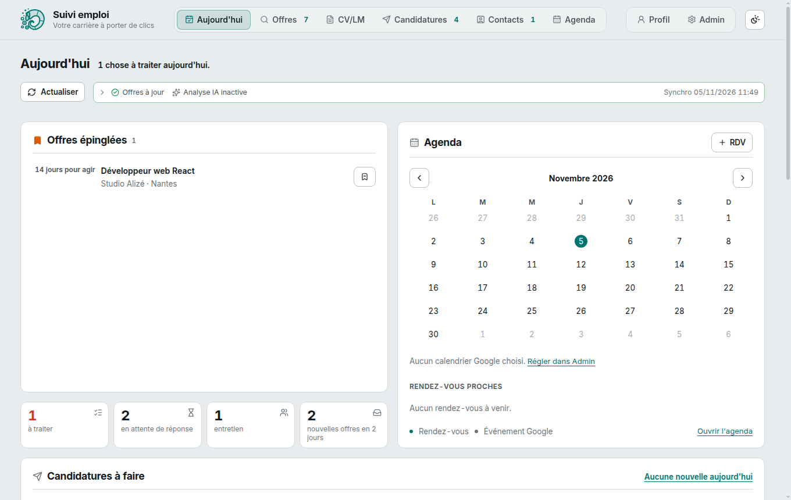
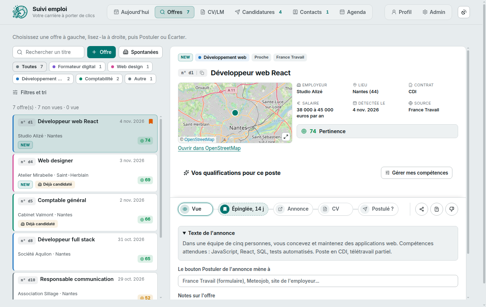
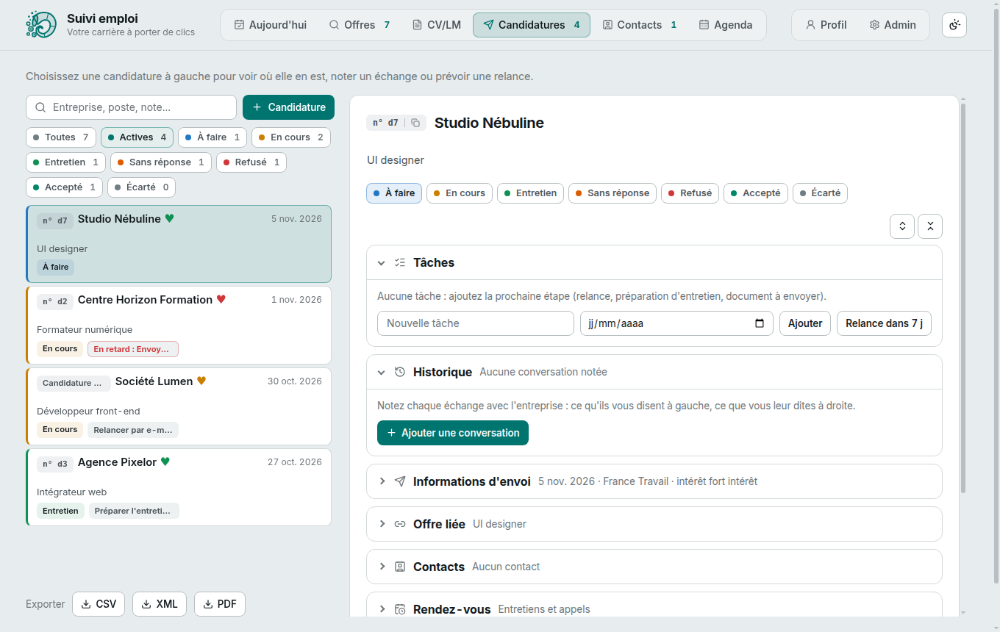

# Suivi emploi

Votre carrière à porter de clics : une application locale pour suivre ses offres d'emploi et ses candidatures, de la première lecture d'une annonce jusqu'à la réponse de l'employeur.

Tout tourne sur votre ordinateur. Vos données restent dans un seul fichier, `suivi.db`, et rien ne part vers Internet sauf si vous branchez vous-même une source d'offres, Google Agenda ou un modèle de langage distant.



## Essayer en 2 minutes

Vous n'avez besoin d'aucun compte ni d'aucune clé pour découvrir l'application : une démo avec des données fictives est incluse.

```bash
git clone https://github.com/alternative-rvb/suivi-emploi.git
cd suivi-emploi
npm install
npm run demo
```

Ouvrez ensuite http://localhost:3100. La démo travaille sur une base temporaire, qui est effacée quand vous l'arrêtez avec `Ctrl+C` : elle ne touche jamais à vos vraies données.

#### Prérequis

- Node.js 24 ou plus (`node -v` pour vérifier), avec npm. [nvm](https://github.com/nvm-sh/nvm) permet de l'installer sans toucher au Node du système.
- git, pour récupérer le projet et ses mises à jour.
- Linux ou Windows avec WSL2 (systèmes testés ; macOS devrait fonctionner mais n'est pas vérifié). Sous WSL, `which npm` doit donner un chemin Linux, pas un dossier du disque Windows.
- Facultatif : `pdftotext` (paquet `poppler-utils`) pour lire un CV de référence, Ollama pour l'analyse des annonces.

Détail, piège du double npm sous Windows et liste de ce qui marche sans quoi : voir les [prérequis de la référence](docs/reference.md#prérequis).

## Ce que fait l'application

| Je veux... | Où |
|------------|----|
| Voir ce qui m'attend aujourd'hui : relances, entretiens, offres épinglées | Aujourd'hui |
| Trouver et trier les offres, voir leur score de pertinence et leur distance | Offres |
| Garder une offre 14 jours, la marquer vue, l'écarter, noter si elle a expiré | Offres |
| Suivre mes candidatures : statut, tâches, échanges, rendez-vous, coût du trajet | Candidatures |
| Composer un CV sur mesure à partir de mon profil, puis l'exporter en PDF | CV/LM |
| Écrire une lettre de motivation à partir d'une offre | CV/LM |
| Garder mes contacts (recruteurs, anciens collègues) liés aux candidatures | Contacts |
| Voir mes rendez-vous, avec Google Agenda en option | Agenda |
| Décrire mon parcours, mes compétences, mes projets et mes diplômes | Profil |
| Mesurer mon activité par jour, semaine ou mois et rester motivé (défis, badges) | Profil > Bilan |





Pour apprendre à s'en servir au quotidien, lisez le [guide d'utilisation](docs/guide-utilisation.md). Le détail de chaque écran, l'API et la base sont dans la [référence complète](docs/reference.md).

## Utiliser l'application pour de vrai

#### 1. Installer et construire

```bash
npm install
cp .env.example .env
npm run build
npm start
```

L'application est alors sur http://localhost:3000. Elle démarre même sans configuration : vous pouvez saisir des offres à la main avec le bouton « Offre » et suivre vos candidatures tout de suite.

#### 2. Récupérer des offres automatiquement (facultatif)

Les offres viennent de l'API de France Travail.

1. Créez une application sur [francetravail.io](https://francetravail.io) et ajoutez-lui l'API Offres d'emploi.
2. Recopiez les deux clés dans votre fichier `.env` (`FT_CLIENT_ID` et `FT_CLIENT_SECRET`).
3. Relancez le serveur : la synchronisation remplit la liste, et le bouton « Actualiser » la relance.

Le fichier `.env` n'est jamais versionné. Chaque variable est commentée dans `.env.example`.

#### 3. Indiquer votre zone (facultatif)

Dans `.env`, deux lignes suffisent pour que l'application marque les offres proches de chez vous :

```text
SUIVI_DEPARTEMENT_PROCHE=44
SUIVI_VILLES_PROCHES=Nantes,Saint-Herblain
```

Pour que le score tienne compte de la distance en kilomètres, ajoutez un ou plusieurs points de départ « latitude,longitude » (clic droit sur une carte en ligne pour les obtenir) :

```text
SUIVI_ORIGINES=47.2184,-1.5536
```

#### 4. Aller plus loin (facultatif)

| Option | Ce que ça apporte | Comment |
|--------|-------------------|---------|
| Candidatures spontanées | Entreprises qui recrutent souvent, via La Bonne Boite | `FT_SCOPE_BONNEBOITE` dans `.env` |
| Marché local | Carte « offres pour 100 demandeurs » par métier sur l'accueil | `FT_SCOPE_MARCHE` dans `.env` |
| Google Agenda | Vos rendez-vous dans l'application | Préparation décrite dans la [référence](docs/reference.md) |
| Analyse des annonces | Compétences relevées par un modèle local (Ollama) | `ANALYSE_PROVIDER` dans `.env` |
| Copie de sauvegarde | Une copie de la base par jour dans un autre dossier | `SUIVI_EXPORT_DIR` dans `.env` |

## Vos données

- Tout est dans `suivi.db`, à la racine du projet. Le serveur en copie une version par jour dans `data/backups/`.
- `suivi.db`, `data/` et `.env` sont exclus de git : ils ne peuvent pas partir par erreur sur un dépôt.
- Ne placez pas le dossier dans un dossier synchronisé (Dropbox, cloud personnel) : SQLite gère mal les verrous de fichiers sur ces partages.

## Pour les développeurs

```bash
npm run dev        # serveur (port 3000) et interface avec rechargement (port 5173)
npm test           # tests automatiques, sans réseau
npm run typecheck  # vérification des types
npm run build      # construit l'interface dans dist/
```

Pile technique : Node.js 24, SQLite intégré (`node:sqlite`), serveur `node:http` sans framework, React 19, TypeScript et Vite, CSS maison. Aucune dépendance serveur lourde.

L'API, la base de données, les règles de fusion des offres et le dépannage sont décrits dans la [référence complète](docs/reference.md). Les contributions et les retours sont les bienvenus via les issues du dépôt.

## Nouveautés et retours

- Les changements de chaque version sont dans le [journal des versions](CHANGELOG.md) et sur la page Releases du dépôt.
- Un bug ou une idée : ouvrez une [issue](https://github.com/alternative-rvb/suivi-emploi/issues/new/choose). N'y mettez aucune donnée personnelle, elles sont publiques.

## Licence et auteur

Code publié sous licence MIT (voir [LICENSE](LICENSE)). Projet développé par Alternative RVB, consultant et formateur digital freelance : [www.alternative-rvb.com](https://www.alternative-rvb.com).
